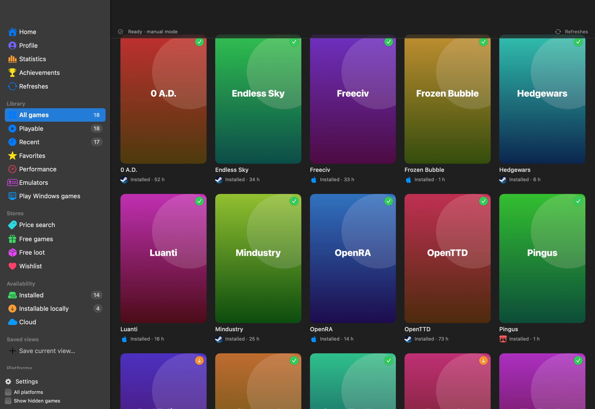
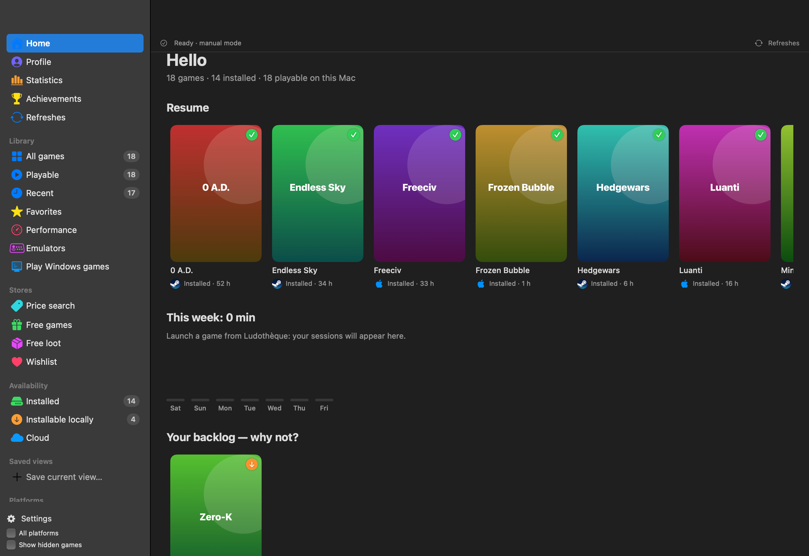
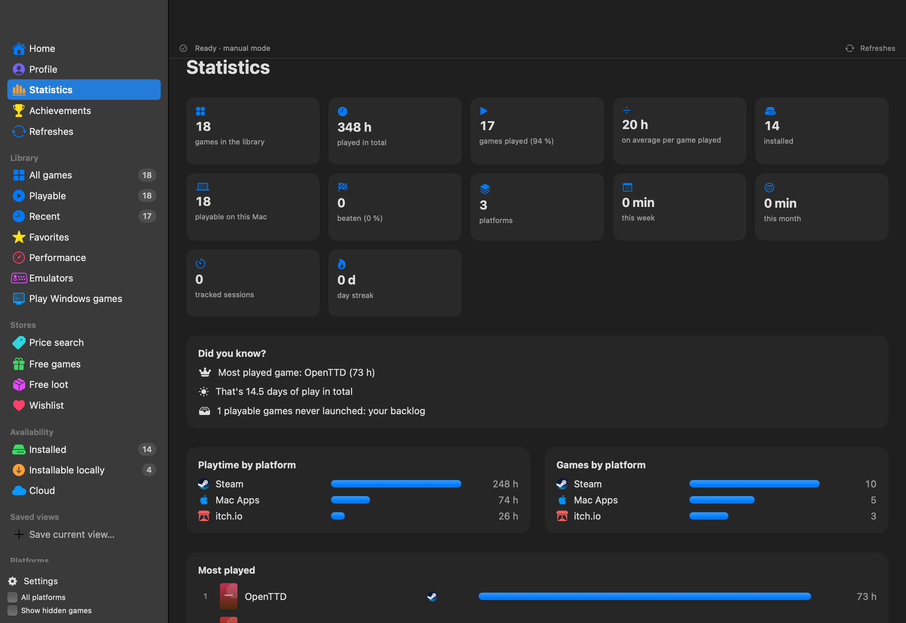

<p align="center"></p>

# Ludothèque

[English](README.md) · [Français](README.fr.md) · **Español**

**Todos tus juegos en un solo lugar, en Mac.** Un lanzador nativo (SwiftUI, universal Apple Silicon + Intel) que reúne Steam, Epic, GOG, Xbox, PlayStation, Nintendo, Battle.net, juegos de Mac, emuladores y muchos más, en el espíritu de Playnite.

**8 idiomas**: español, inglés, francés, alemán, italiano, portugués, chino y japonés. El idioma del Mac se elige automáticamente; *Opciones › General › Idioma* permite cambiarlo.

👉 **[Descargar Ludothèque para macOS](https://github.com/jeremdevgit/ludotheque/releases/latest)** (`.pkg` o `.dmg`, macOS 14 o posterior)



## Funciones

- **Plataformas**: Steam, Epic Games, GOG, Xbox / Microsoft (incluido Minecraft), PlayStation, Nintendo, Battle.net, EA, Ubisoft Connect, Riot Games, itch.io, Amazon Games, Humble Bundle, App Store / Apple Arcade, Google Play Games, Rockstar, Bethesda, IndieGala, Fanatical, Green Man Gaming, Paradox, Wargaming, Meta Quest, CrossOver / Wine, PlayCover, emulación…
- **Detección automática** de los juegos instalados (Steam, Epic, GOG Galaxy, Battle.net, EA, Heroic, itch, App Store mediante Spotlight, CrossOver, PlayCover…) e importación de las bibliotecas conectadas a GOG Galaxy.
- **Gestión de plataformas** (⇧⌘P): conexión de las cuentas de Steam, Epic, GOG, Xbox (OpenXBL), PlayStation, Nintendo, itch.io y Humble; importación de las exportaciones de datos de Apple (privacy.apple.com) y Google (Takeout). Botón **Buscar juegos** (⌘R).
- **Duplicados agrupados** bajo una sola portada con los logotipos de las plataformas.
- **Filtros**: instalado, instalable localmente, nube, estado, plataformas, etiquetas, nota, Mac nativo; vistas guardadas.
- **Ficha del juego**: descripción, géneros, desarrollador, capturas, estado de progreso, nota, etiquetas, notas, título/portada personalizados.
- **Contador de tiempo de juego**, **juego al azar**, **estadísticas**, **vista de lista**, secciones.
- **Emuladores**: perfiles (Ryujinx, Dolphin, Cemu, Azahar, melonDS, mGBA, PPSSPP, DuckStation, PCSX2, OpenEmu, RetroArch) e importación de ROM con portadas de libretro.
- **Modo TV** a pantalla completa con mando (⇧⌘T).
- **Rendimiento**: compara tu Mac con los requisitos del sistema (PCGamingWiki, Steam, GOG) para los objetivos 1080p 60 / 1440p 144 (ajustables).
- Introducción manual de cualquier juego, exportación CSV, copia de seguridad / restauración.
- **Inicio**, **Perfil** para compartir (PNG, JPEG, PDF, CSV, JSON, Markdown), **Estadísticas** detalladas, **Logros** (Steam, Xbox, PlayStation).
- **Tiendas**: juegos y objetos gratis (GamerPower), lista de deseos con alertas de precio, precios de claves (DLCompare).
- **Jugar a juegos de Windows**: comprobación del Mac, herramientas (Heroic, CrossOver, Whisky…), instalación de los lanzadores de Windows en un clic, método recomendado para cada juego (con detección de antitrampas).
- **Desinstalación** conservando la configuración o completa (a la Papelera).
- Tareas largas en segundo plano con barra de progreso detallada; **Opciones** completas (barra lateral, inicio, importar/exportar…).

<p> </p>

*Capturas realizadas con una biblioteca de demostración de juegos libres y gratuitos (portadas generadas).*

## Instalar

- **Paquete `.pkg` (recomendado)**: doble clic y seguir el asistente. **La versión anterior se cierra y se elimina automáticamente** antes de instalar; se conservan tu biblioteca, tus ajustes y tus credenciales (Llavero).
- **Imagen `.dmg`**: arrastra Ludothèque a la carpeta Aplicaciones (el Finder ofrece sustituir la versión anterior).

La app no está notarizada por Apple: la primera vez, haz **clic derecho › Abrir**, o *Ajustes del Sistema › Privacidad y seguridad › Abrir igualmente*. Para comprobar los archivos: `shasum -a 256 -c SHA256SUMS.txt --ignore-missing`.

Menú **Ayuda › Mis otros programas…** y *Opciones › Acerca de*: créditos y enlaces a mis otros programas.

## Privacidad

La app no incluye ningún dato personal. Todo se crea en el Mac del usuario en el primer arranque:

| Dato | Ubicación |
|---|---|
| Biblioteca, estados, notas, juegos manuales, emuladores | `~/Library/Application Support/Ludotheque/` |
| Credenciales de las plataformas | Llavero de macOS |
| Portadas y logotipos | `~/Library/Caches/Ludotheque/` |

Servicios contactados: las plataformas que conecta el usuario, GOG GamesDB (títulos, portadas, descripciones), PCGamingWiki / Steam / GOG (requisitos del sistema), el servicio de iconos de Google (logotipos), thumbnails.libretro.com (portadas de las ROM).

**Identificadores públicos de los clientes oficiales**: las conexiones de GOG, Epic y PlayStation usan los identificadores públicos de los clientes oficiales de esas plataformas, conocidos por todos y usados por las mismas herramientas libres (Heroic, Legendary, psn-api). No son secretos: no se incluye ningún identificador personal y los del usuario se quedan en su Llavero.

¿Has encontrado una vulnerabilidad? Lee [SECURITY.md](SECURITY.md).

## Compilar

Requisitos: macOS 14+, Xcode o las Command Line Tools (Swift 5.10+).

```sh
./scripts/build-app.sh
# → dist/Ludothèque.app, dist/Ludotheque-<versión>.dmg, dist/Ludotheque-<versión>.pkg y dist/SHA256SUMS.txt
```

Variables opcionales: `VERSION`, `BUNDLE_ID`, `SIGN_IDENTITY` (certificado «Developer ID Application»), `SIGN_INSTALLER_IDENTITY` («Developer ID Installer», para el .pkg) y `NOTARY_PROFILE` (perfil de `notarytool`) para instaladores firmados y notarizados, sin aviso de Gatekeeper. El script se niega a publicar si la ruta de la carpeta personal de la máquina de compilación aparece en el binario.

## Traducciones

Los textos están en `Resources/<idioma>.lproj/Localizable.strings`, donde el texto francés sirve de clave; el inglés sirve de reserva cuando el idioma del Mac no está disponible. La lista de textos la regenera el compilador: `swift build -Xswiftc -emit-localized-strings -Xswiftc -emit-localized-strings-path -Xswiftc <carpeta>`.

## Limitaciones conocidas

- Las integraciones de GOG, Epic, PlayStation, Nintendo y Humble usan API no oficiales (las mismas que Heroic, Playnite o nxapi), que pueden cambiar.
- Apple y Google no ofrecen API de compras: sus juegos no instalados pasan por la importación de las exportaciones de datos oficiales.
- Los veredictos de rendimiento son estimaciones (índice de GPU, penalización por traducción en los juegos de Windows).

## Licencia

Código bajo licencia **GNU GPL v3 o posterior**: consulta [LICENSE](LICENSE). Copyright © 2026 jeremdevgit.

Ludothèque no está afiliada a ninguna de las plataformas citadas; sus nombres y logotipos pertenecen a sus propietarios.

## Mis otros programas

Todos libres, gratuitos y sin publicidad: [github.com/jeremdevgit](https://github.com/jeremdevgit)

| Programa | Para | En breve |
|---|---|---|
| [Boîte à outils](https://github.com/jeremdevgit/boite-a-outils) | Windows, macOS | mantenimiento, limpieza y ajustes ocultos |
| [Pomme](https://github.com/jeremdevgit/pomme) | Windows | reproductor de Apple Music y música local |
| [rJb](https://github.com/jeremdevgit/rjb) | Windows | la iluminación RGB de todos tus dispositivos |
| [Suite Libre](https://jeremdevgit.github.io/suite-libre/) | navegador | seis herramientas sin cuenta: códigos QR, desenfoque, fotos, conversiones, medias, contraseñas |
| [Batailles de France](https://github.com/jeremdevgit/batailles-de-france) | navegador | juego de estrategia en tiempo real sobre cinco ciudades francesas |
