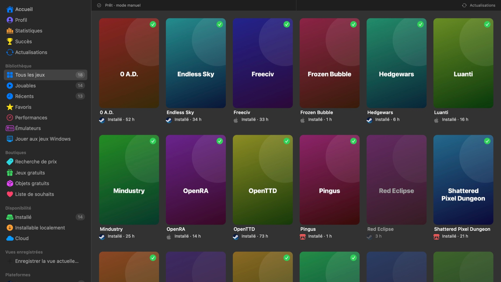
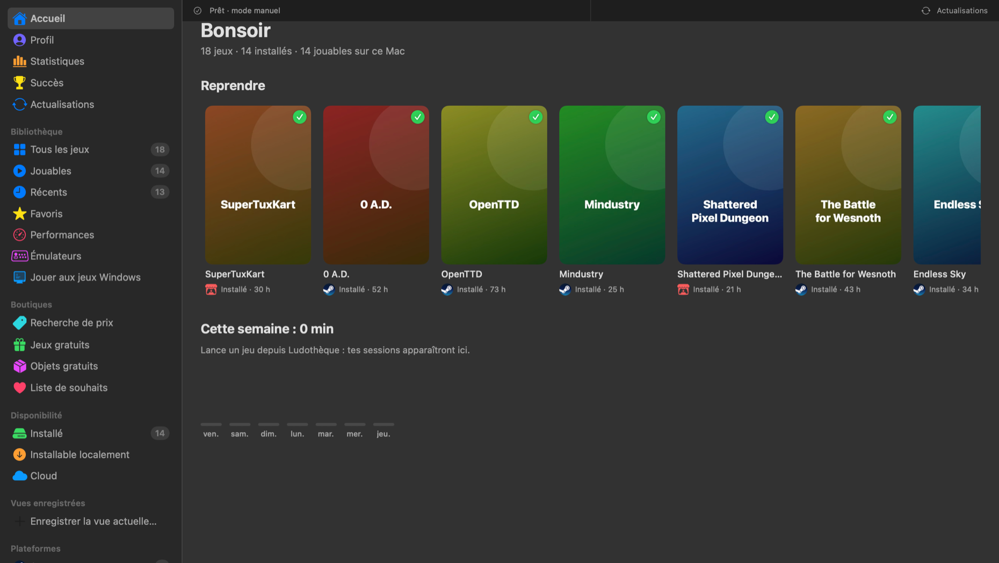
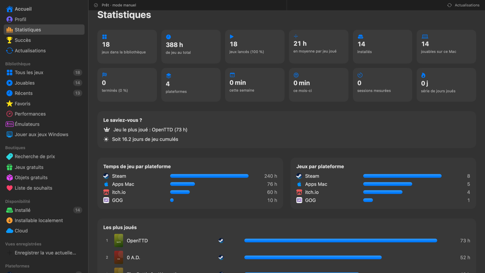

<p align="center"></p>

# Ludothèque

[English](README.md) · **Français** · [Español](README.es.md)

**Tous tes jeux au même endroit, sur Mac.** Un lanceur natif (SwiftUI, universel Apple Silicon + Intel) qui regroupe Steam, Epic, GOG, Xbox, PlayStation, Nintendo, Battle.net, les jeux Mac, les émulateurs et bien d'autres, dans l'esprit de Playnite.

**8 langues** : français, anglais, espagnol, allemand, italien, portugais, chinois et japonais. La langue du Mac est choisie automatiquement ; *Options › Général › Langue* permet d'en changer.

👉 **[Télécharger Ludothèque pour macOS](https://github.com/jeremdevgit/ludotheque/releases/latest)** (`.pkg` ou `.dmg`, macOS 14 et plus récent)



## Fonctionnalités

- **Plateformes** : Steam, Epic Games, GOG, Xbox / Microsoft (dont Minecraft), PlayStation, Nintendo, Battle.net, EA, Ubisoft Connect, Riot Games, itch.io, Amazon Games, Humble Bundle, App Store / Apple Arcade, Google Play Games, Rockstar, Bethesda, IndieGala, Fanatical, Green Man Gaming, Paradox, Wargaming, Meta Quest, CrossOver / Wine, PlayCover, émulation…
- **Détection automatique** des jeux installés (Steam, Epic, GOG Galaxy, Battle.net, EA, Heroic, itch, App Store via Spotlight, CrossOver, PlayCover…) et import des bibliothèques connectées à GOG Galaxy.
- **Gestion des plateformes** (⇧⌘P) : connexion des comptes Steam, Epic, GOG, Xbox (OpenXBL), PlayStation, Nintendo, itch.io, Humble ; import des exports Apple (privacy.apple.com) et Google (Takeout). Bouton **Rechercher les jeux** (⌘R).
- **Regroupement** des doublons sous une seule jaquette avec les logos des plateformes.
- **Filtres** : installé, installable localement, cloud, statut, plateformes, tags, note, Mac natif ; vues enregistrées.
- **Fiche jeu** : description, genres, développeur, captures, statut de progression, note, tags, notes, titre/jaquette personnalisés.
- **Compteur de temps de jeu**, **jeu au hasard**, **statistiques**, **vue liste**, sections.
- **Émulateurs** : profils (Ryujinx, Dolphin, Cemu, Azahar, melonDS, mGBA, PPSSPP, DuckStation, PCSX2, OpenEmu, RetroArch) et import des ROM avec jaquettes libretro.
- **Mode TV** plein écran à la manette (⇧⌘T).
- **Performances** : compare votre Mac aux configurations requises (PCGamingWiki, Steam, GOG) pour les cibles 1080p 60 / 1440p 144 (réglables).
- Saisie manuelle de n'importe quel jeu, export CSV, sauvegarde / restauration.
- **Accueil**, **Profil** partageable (PNG, JPEG, PDF, CSV, JSON, Markdown), **Statistiques** détaillées, **Succès** (Steam, Xbox, PlayStation).
- **Boutiques** : jeux et objets gratuits (GamerPower), liste de souhaits avec alertes de prix, prix des clés CD (DLCompare).
- **Jouer aux jeux Windows** : vérification du Mac, outils (Heroic, CrossOver, Whisky…), installation des launchers Windows en un clic, méthode conseillée par jeu (avec détection des anti-triche).
- **Désinstallation** en gardant la configuration ou complète (vers la Corbeille).
- Tâches longues en arrière-plan avec barre de progression détaillée ; **Options** complètes (barre latérale, démarrage, import/export…).

<p> </p>

*Captures réalisées avec une bibliothèque de démonstration de jeux libres et gratuits (jaquettes générées).*

## Installer

- **Paquet `.pkg` (conseillé)** : double-clic, puis suivre l'assistant. **L'ancienne version est fermée et retirée automatiquement** avant l'installation ; ta bibliothèque, tes réglages et tes identifiants (Trousseau) sont conservés.
- **Image `.dmg`** : glisser Ludothèque sur le dossier Applications (le Finder propose de remplacer l'ancienne version).

L'application n'est pas notarisée par Apple : au premier lancement, fais **clic droit › Ouvrir**, ou *Réglages Système › Confidentialité et sécurité › Ouvrir quand même*. Pour vérifier les fichiers : `shasum -a 256 -c SHA256SUMS.txt --ignore-missing`.

Menu **Aide › Mes autres logiciels…** et *Options › À propos* : crédit et liens vers mes autres logiciels.

## Confidentialité

Aucune donnée personnelle n'est incluse dans l'application. Tout est créé sur le Mac de l'utilisateur au premier lancement :

| Donnée | Emplacement |
|---|---|
| Bibliothèque, statuts, notes, jeux manuels, émulateurs | `~/Library/Application Support/Ludotheque/` |
| Identifiants des plateformes | Trousseau macOS |
| Jaquettes et logos | `~/Library/Caches/Ludotheque/` |

Services contactés : les plateformes que l'utilisateur connecte, GOG GamesDB (titres, jaquettes, descriptions), PCGamingWiki / Steam / GOG (configurations requises), le service d'icônes de Google (logos), thumbnails.libretro.com (jaquettes des ROM).


**Identifiants publics des clients officiels** : les connexions GOG, Epic et PlayStation utilisent les identifiants publics des clients officiels de ces plateformes, connus de tous et employés par les mêmes outils libres (Heroic, Legendary, psn-api). Ce ne sont pas des secrets : aucun identifiant personnel n'est inclus, ceux de l'utilisateur restent dans son Trousseau.

Une faille ? Merci de lire [SECURITY.md](SECURITY.md).

## Compiler

Prérequis : macOS 14+, Xcode ou les Command Line Tools (Swift 5.10+).

```sh
./scripts/build-app.sh
# → dist/Ludothèque.app, dist/Ludotheque-<version>.dmg, dist/Ludotheque-<version>.pkg et dist/SHA256SUMS.txt
```

Variables optionnelles : `VERSION`, `BUNDLE_ID`, `SIGN_IDENTITY` (certificat « Developer ID Application »), `SIGN_INSTALLER_IDENTITY` (« Developer ID Installer », pour le .pkg) et `NOTARY_PROFILE` (profil `notarytool`) pour des installateurs signés et notarisés, sans avertissement Gatekeeper. Le script refuse de livrer si le chemin du dossier personnel de la machine de compilation apparaît dans le binaire.

## Traductions

Les textes sont dans `Resources/<langue>.lproj/Localizable.strings`, où le texte français sert de clé ; l'anglais sert de repli quand la langue du Mac n'est pas proposée. La liste des textes se régénère avec le compilateur : `swift build -Xswiftc -emit-localized-strings -Xswiftc -emit-localized-strings-path -Xswiftc <dossier>`.

## Limites connues

- Les intégrations GOG, Epic, PlayStation, Nintendo et Humble utilisent des API non officielles (les mêmes que Heroic, Playnite ou nxapi) qui peuvent changer.
- Apple et Google n'offrent pas d'API d'achats : leurs jeux non installés passent par l'import des exports de données officiels.
- Les verdicts de performances sont des estimations (indice GPU, pénalité de traduction pour les jeux Windows).

## Licence

Code sous licence **GNU GPL v3 ou ultérieure** — voir [LICENSE](LICENSE). Copyright © 2026 jeremdevgit.

Ludothèque n'est affiliée à aucune des plateformes citées ; leurs noms et logos appartiennent à leurs propriétaires.

## Mes autres logiciels

Tous libres, gratuits et sans publicité — [github.com/jeremdevgit](https://github.com/jeremdevgit) :

| Logiciel | Plateforme | En bref |
|---|---|---|
| [AutoDex](https://github.com/jeremdevgit/autodex) | Windows, macOS, Linux | Jeu de collection de voitures avec reconnaissance de photos sur l'appareil |
| [Boîte à outils](https://github.com/jeremdevgit/boite-a-outils) | Windows, macOS | Entretien de l'ordinateur, nettoyage et recherche de fichiers |
| [Carnet de notes](https://github.com/jeremdevgit/carnet-rust) | Windows | Carnets chiffrés et synchronisation expérimentale |
| [Decklight](https://github.com/jeremdevgit/decklight) | Windows, macOS, Linux | Stream Deck virtuel avec contrôle USB |
| [JMeca](https://github.com/jeremdevgit/jmeca) | Windows, macOS, Linux | Suivi d'entretien de véhicules chiffré |
| [LJ Hub](https://github.com/jeremdevgit/lj-hub) | Windows, macOS, Linux | Gestionnaire de profils pour appareils Logitech |
| [Pomme](https://github.com/jeremdevgit/pomme) | Windows | Lecteur de musique Apple Music et fichiers locaux |
| [rJb](https://github.com/jeremdevgit/rjb) | Windows | Contrôle de l'éclairage RGB |
| [Suite Libre](https://jeremdevgit.github.io/suite-libre/) | Navigateur | Six outils sans compte |
| [Batailles de France](https://github.com/jeremdevgit/batailles-de-france) | Navigateur | Jeu de stratégie en temps réel |
