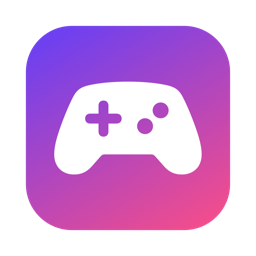
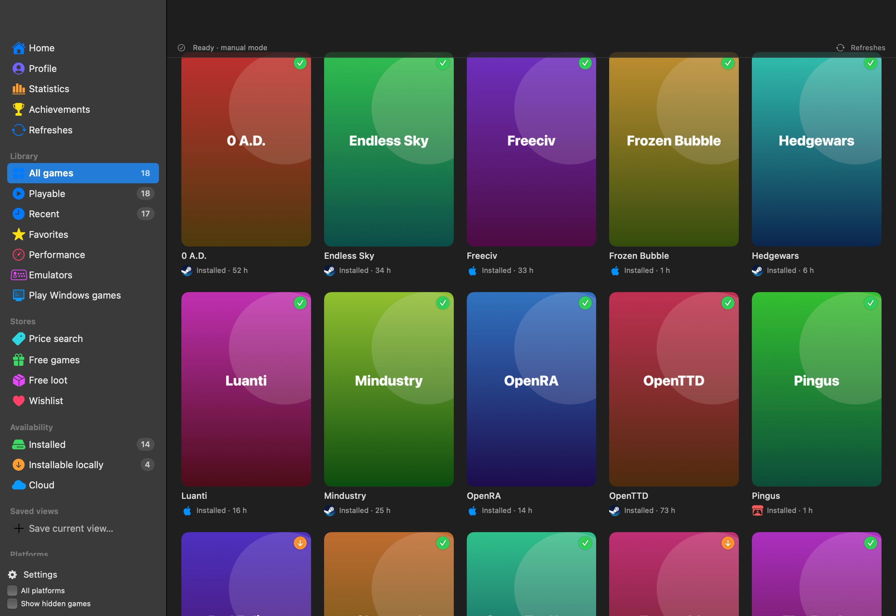
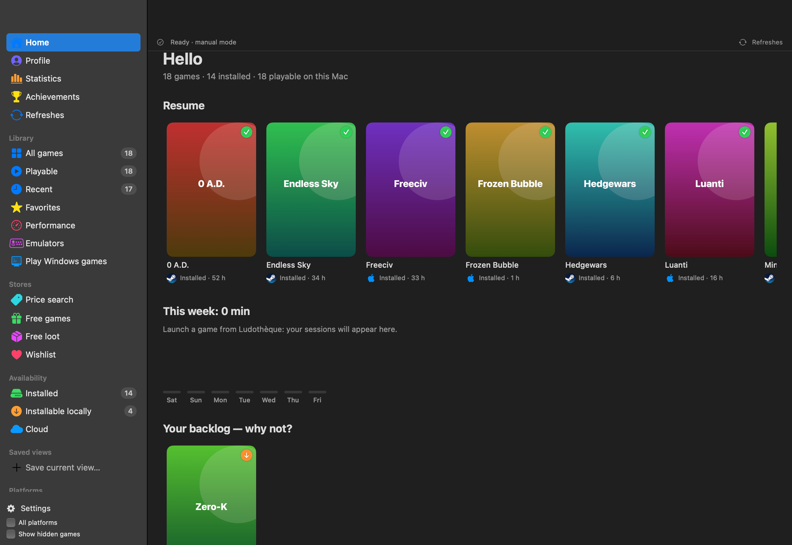
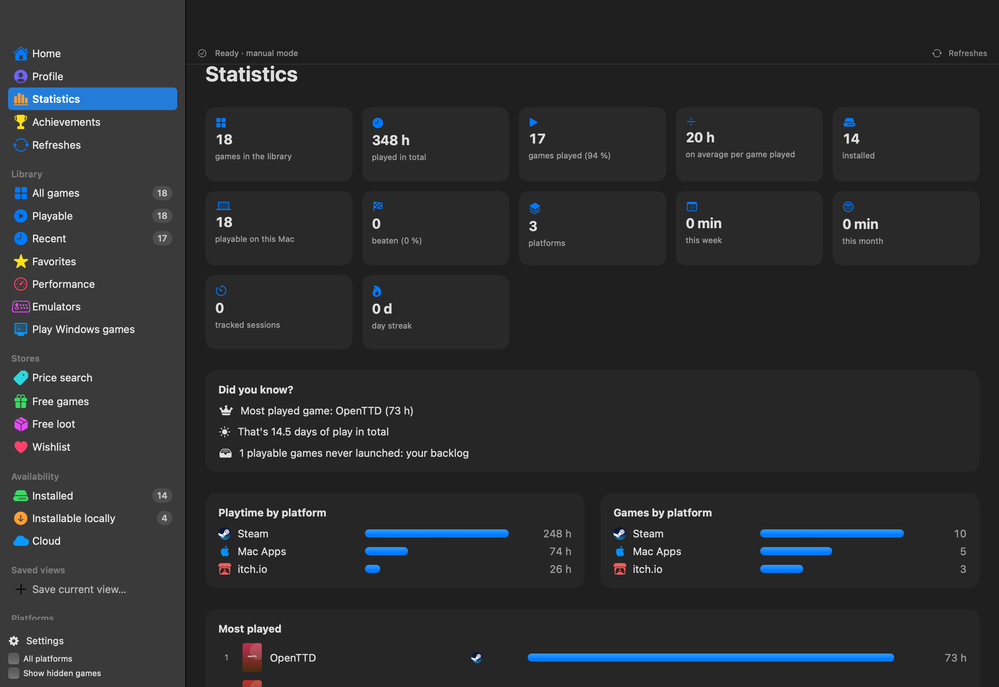

<p align="center"></p>

# Ludothèque

**English** · [Français](README.fr.md) · [Español](README.es.md)

**All your games in one place, on Mac.** A native launcher (SwiftUI, universal Apple Silicon + Intel) that brings together Steam, Epic, GOG, Xbox, PlayStation, Nintendo, Battle.net, Mac games, emulators and many more, in the spirit of Playnite.

**8 languages**: English, French, Spanish, German, Italian, Portuguese, Chinese and Japanese. Your Mac's language is picked automatically; *Options › General › Language* lets you switch.

👉 **[Download Ludothèque for macOS](https://github.com/jeremdevgit/ludotheque/releases/latest)** (`.pkg` or `.dmg`, macOS 14 or later)



## Features

- **Platforms**: Steam, Epic Games, GOG, Xbox / Microsoft (including Minecraft), PlayStation, Nintendo, Battle.net, EA, Ubisoft Connect, Riot Games, itch.io, Amazon Games, Humble Bundle, App Store / Apple Arcade, Google Play Games, Rockstar, Bethesda, IndieGala, Fanatical, Green Man Gaming, Paradox, Wargaming, Meta Quest, CrossOver / Wine, PlayCover, emulation…
- **Automatic detection** of installed games (Steam, Epic, GOG Galaxy, Battle.net, EA, Heroic, itch, App Store via Spotlight, CrossOver, PlayCover…) and import of libraries connected to GOG Galaxy.
- **Platform manager** (⇧⌘P): sign in to Steam, Epic, GOG, Xbox (OpenXBL), PlayStation, Nintendo, itch.io, Humble; import Apple (privacy.apple.com) and Google (Takeout) data exports. **Search for games** button (⌘R).
- **Duplicates grouped** under a single cover with the platforms' logos.
- **Filters**: installed, installable locally, cloud, status, platforms, tags, rating, native Mac; saved views.
- **Game page**: description, genres, developer, screenshots, progress status, rating, tags, notes, custom title/cover.
- **Playtime tracking**, **random game**, **statistics**, **list view**, sections.
- **Emulators**: profiles (Ryujinx, Dolphin, Cemu, Azahar, melonDS, mGBA, PPSSPP, DuckStation, PCSX2, OpenEmu, RetroArch) and ROM import with libretro covers.
- Full-screen **TV mode** with a gamepad (⇧⌘T).
- **Performance**: compares your Mac with system requirements (PCGamingWiki, Steam, GOG) for 1080p 60 / 1440p 144 targets (adjustable).
- Manual entry of any game, CSV export, backup / restore.
- **Home**, shareable **Profile** (PNG, JPEG, PDF, CSV, JSON, Markdown), detailed **Statistics**, **Achievements** (Steam, Xbox, PlayStation).
- **Stores**: free games and loot (GamerPower), wishlist with price alerts, CD key prices (DLCompare).
- **Play Windows games**: Mac check, tools (Heroic, CrossOver, Whisky…), one-click install of Windows launchers, recommended method per game (with anti-cheat detection).
- **Uninstall** keeping the settings, or completely (to the Trash).
- Long tasks run in the background with a detailed progress bar; complete **Options** (sidebar, startup, import/export…).

<p> </p>

*Screenshots taken with a demo library of free and open-source games (generated covers).*

## Installing

- **`.pkg` package (recommended)**: double-click and follow the assistant. **The previous version is closed and removed automatically** before installing; your library, settings and credentials (Keychain) are kept.
- **`.dmg` image**: drag Ludothèque to the Applications folder (the Finder offers to replace the old version).

The app isn't notarized by Apple: on first launch, **right-click › Open**, or *System Settings › Privacy & Security › Open Anyway*. To check the files: `shasum -a 256 -c SHA256SUMS.txt --ignore-missing`.

**Help › My other software…** menu and *Options › About*: credits and links to my other software.

## Privacy

No personal data is included in the app. Everything is created on the user's Mac at first launch:

| Data | Location |
|---|---|
| Library, statuses, ratings, manual games, emulators | `~/Library/Application Support/Ludotheque/` |
| Platform credentials | macOS Keychain |
| Covers and logos | `~/Library/Caches/Ludotheque/` |

Services contacted: the platforms the user connects, GOG GamesDB (titles, covers, descriptions), PCGamingWiki / Steam / GOG (system requirements), Google's icon service (logos), thumbnails.libretro.com (ROM covers).

**Public IDs of the official clients**: the GOG, Epic and PlayStation sign-ins use the public client IDs of those platforms' official clients, known to everyone and used by the same open-source tools (Heroic, Legendary, psn-api). They aren't secrets: no personal identifier is included, and the user's own credentials stay in their Keychain.

Found a vulnerability? Please read [SECURITY.md](SECURITY.md).

## Building

Requirements: macOS 14+, Xcode or the Command Line Tools (Swift 5.10+).

```sh
./scripts/build-app.sh
# → dist/Ludothèque.app, dist/Ludotheque-<version>.dmg, dist/Ludotheque-<version>.pkg and dist/SHA256SUMS.txt
```

Optional variables: `VERSION`, `BUNDLE_ID`, `SIGN_IDENTITY` ("Developer ID Application" certificate), `SIGN_INSTALLER_IDENTITY` ("Developer ID Installer", for the .pkg) and `NOTARY_PROFILE` (`notarytool` profile) for signed, notarized installers without a Gatekeeper warning. The script refuses to ship if the build machine's home folder path appears in the binary.

## Translations

Texts are in `Resources/<language>.lproj/Localizable.strings`, where the French text is the key; English is the fallback when the Mac's language isn't available. The list of texts is regenerated by the compiler: `swift build -Xswiftc -emit-localized-strings -Xswiftc -emit-localized-strings-path -Xswiftc <folder>`.

## Known limitations

- The GOG, Epic, PlayStation, Nintendo and Humble integrations use unofficial APIs (the same as Heroic, Playnite or nxapi), which can change.
- Apple and Google offer no purchases API: their non-installed games go through importing the official data exports.
- Performance verdicts are estimates (GPU index, translation penalty for Windows games).

## License

Code under the **GNU GPL v3 or later** — see [LICENSE](LICENSE). Copyright © 2026 jeremdevgit.

Ludothèque isn't affiliated with any of the platforms mentioned; their names and logos belong to their owners.

## My other software

All free, open source and ad-free — [github.com/jeremdevgit](https://github.com/jeremdevgit):

| Software | For | In short |
|---|---|---|
| [JMeca](https://github.com/jeremdevgit/jmeca) | Windows, macOS, Linux | encrypted vehicle maintenance, client folders, service log and fuel tracking |
| [Boîte à outils](https://github.com/jeremdevgit/boite-a-outils) | Windows, macOS | maintenance, cleanup and hidden settings |
| [Pomme](https://github.com/jeremdevgit/pomme) | Windows | Apple Music and local music player |
| [rJb](https://github.com/jeremdevgit/rjb) | Windows | RGB lighting for all your devices in one app |
| [Suite Libre](https://jeremdevgit.github.io/suite-libre/) | browser | six tools, no account: QR codes, blur, photos, conversions, averages, passwords |
| [Batailles de France](https://github.com/jeremdevgit/batailles-de-france) | browser | real-time strategy game on the maps of five French cities |
